# FIT-08 progress — 2026-11-13

**Status: In progress. This branch is a requested progress publication.**
The production fitting workflow has not passed the complete FIT-08 acceptance.
The engine-parity epic remains open. A successful reference experiment below
does not mark the integrated task Done.

## Latest checkpoint — repeatable native extraction, fit still rejected

The private host wrapper now has a parameterized native-reference extraction
command. An explicit recipe pins the selected native project/preset, exact body
and parts, skeleton, default Bijin skin, tools and maps. The adapter composes the
existing native build, common-frame assembly and Blender importer; it adds no
fitting algorithm or cloth solver. Eleven portable controls cover refusals,
failed receipts, input drift and child-process cleanup. Independent advisory
review findings were reproduced and repaired.

Fresh `_0` and `_1` runs each preserve57 declared input pins. Their native NIFs
are byte-identical to the earlier replay; geometry, triangles, UVs, bones,
weights and materials match on all eight assembled meshes. Fresh Blender opens
pass source/rest/image checks and controlled body/hands/robe pose smoke tests.
`Produced` describes transport through these stages, not an accepted fit.

The fixed Lydia head initially misses exact Bijin `_0` by up to10.109mm.
Registry `component.seam_fit` now fits explicit original-vertex targets and
fades displacement over shortest mesh-edge distance. It preserves render order;
exact coincident aliases share only the distance graph. Source frame/lengths
are explicit, contradictory targets and excessive shifts refuse, and all
outside-support positions remain unchanged. No cloth solver or automatic anatomy
recognition is added. The optional extraction stage retains the raw assembly.

Fresh real head repairs change55vertices at `_0` and54 at `_1`, leaving941/942
facial vertices unchanged. Seven other meshes, head topology/UV/weights/materials
and the rig remain unchanged. Measured neck pairs now coincide at rest and in
five actual Forearm/Calf/Spine2-driver poses on both endpoints. Worst remaining
hand/foot gaps are0.0557mm (`_0`) and0.1742mm (`_1`). Nonmoving child-bone probes
were rejected before selecting these actual seam drivers. The head inherits112
self-contact witnesses; exact witness comparison finds none added by this repair.
No triangle orientation reversal was introduced. Inherited head contacts remain
disclosed; this is bounded collar repair, not a fully validated appearance asset.

| Bijin0 original neck | Same frame after bounded collar repair |
|---|---|
| 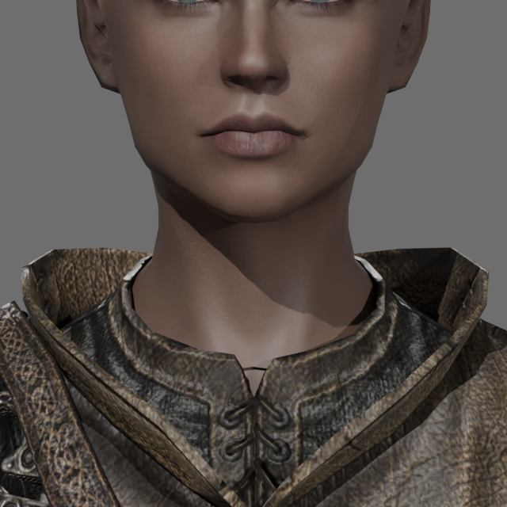 | 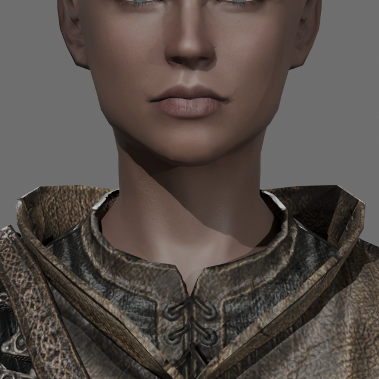 |
|  | 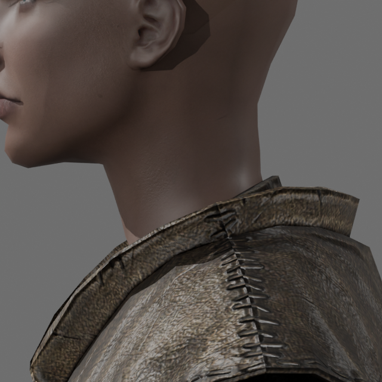 |

These matched rest crops retain all geometry. The front shows the closed lower
neck gap; the robe obscures much of the join in the side crop. They do not prove
full animation, material fidelity or garment clearance.
The rejected torso fit below also remains open. One robe does not establish
the required broad Bijin/Mike clothing-cohort acceptance.

## Exact Bijin native pair and textured handoff

A native custom-reference pilot now produces distinct Apprentice robe endpoints
against the exact Bijin Warmaidens option03 CBBE pair. This is a measured native
preparation/extraction reference, **not an accepted fit or a completed Sculpto
pipeline**. Each assembly retains the original full body, matching hands/feet,
a verified human Nord Lydia head with eyes/brows/mouth, and the native-built robe:
eight meshes, 12,184 vertices, 19,746 triangles and one 89-node rig. The dense 3BA
conversion reference is excluded from the accepted-body assembly.

The target body endpoints differ by up to 1.6232 coordinate units; each remains
unchanged within 7.56e-6 units in the declared common frame. Native preset routing
selects the independent Bijin0 morph at `_0` and Bijin1 at `_1`. The paired `_1`
garment reproduces the earlier pilot exactly. A +0.125X control is consumed within
1.91e-6 units on all 18,436 auxiliary-reference vertices and 3,152/3,164 robe
vertices. The 12 unmapped vertices are six duplicated lower-skirt positions;
they remain disclosed. Native garment topology, UVs, weights, binds, bone names
and texture references match the original authored garment. Three auxiliary-body
weight rows change by at most 1.91e-6 during native saving; that auxiliary body
never replaces Bijin.

Both textured endpoints survive fresh Blender 5.2.3 reopen with source geometry,
UVs, weights and three controlled skin poses on every mesh. Maximum measured
skin prediction error is 1.67e-5 source units. Twenty-five named texture paths
resolve explicitly; all 16 diffuse/normal images used by the material graphs
decode from packed bytes matching their pinned sources. Skin comes from the
supplied Bijin Skin CBBE defaults, rather than an unverified game Data alias.
Measured XZY model-space normal decoding gives body mean agreement 0.974 versus
0.428 for XYZ. This does not establish full Skyrim shader or animation parity.
The chosen default skin replaces Lydia's NPC FaceTint appearance deliberately;
her geometry is a replaceable human head. Hair is outside this pilot.

**The fit fails visibly and numerically.** With the full exact body and feet
retained, `_0` has 1,667 intersecting triangle pairs and `_1` has 1,849. Their
self-contact counts are 1,329 and 1,357; the earlier neutral baseline has 1,322,
including 387 exact duplicate face pairs. These totals do not identify new
contacts or prove penetration depth. The original high-endpoint project's only
nonzero default is BodyZap, which removes reference-body vertices, not robe
geometry; an omitted hidden chest-correction explanation was falsified.
No body hiding, contact-driven trimming or blanket garment inflation was used
to turn these failures into passes.

| Rejected fit candidate, front | Rejected fit candidate, side |
|---|---|
| 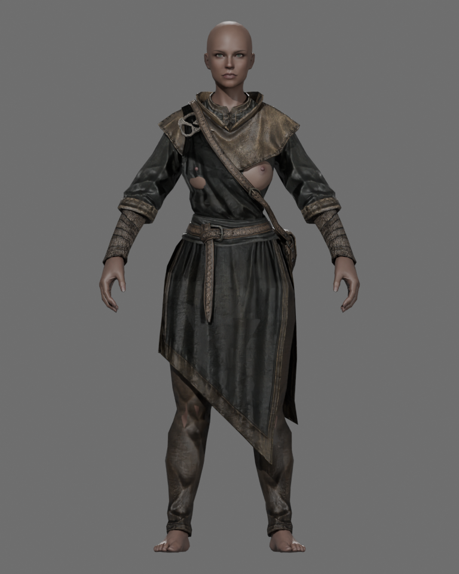 | 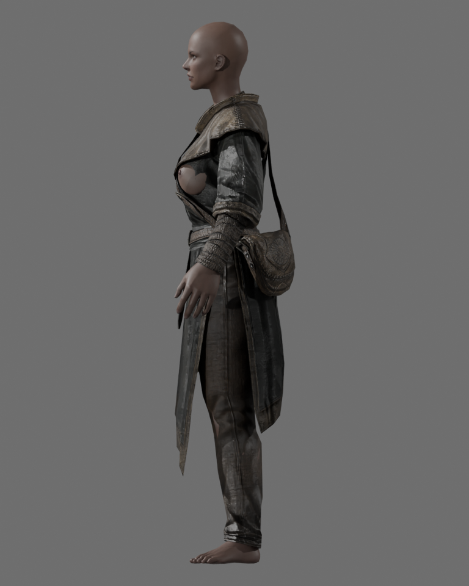 |

These generated rest views show the actual textured candidate at a shared
scale; they are negative review evidence. Ordinary-region clearance and
construction preservation remain unfinished. Blender owns cloth simulation;
the loose robe panels must not be treated as a static shirt fitted to legs.
The earlier foot-isolation smoke also remains failed: a source cross-side toe
weight moves one right-foot vertex during a left-foot twist. Independent skin
evaluation reproduces it; source-weight fidelity is not source-weight quality.
Private source meshes, maps, native projects and blends are not distributed.

## Earlier audit checkpoint — native BodySlide and morph lookup

Native qualification attempted a frozen cohort of **865 BodySlide sets**:
Sentinel HIMBO: 283; Daring Ranger: 2; 3BA: 114; CBBE Outfits: 466. These include
pieces, alternatives and first-person projects, not 865 complete outfits.
Initial strict native success was 809/865. Documented serial diagnosis and one
private filename-case repair produced all expected geometry, while preserving
the original failures. **Three sets still have missing authored morph resources.**
Eight other supplied garment-pack groups need conversion projects. Native
geometry output does not establish complete builds or broad fitting.

Every male native build used HIMBO Mike. Its six body/hands/feet endpoint files
match the accepted outputs byte for byte. Female native builds used CBBE Curvy
solely as a compatibility control; the accepted Bijin body stayed separate and
unchanged. Curvy has 13,554 vertices / 26,286 triangles; Bijin has 3,471 / 6,516.
Complete male/female Blender assemblies with 14/7 meshes pass rest, skin-weight
and nine finite native motion samples each. Continuous clearance, seams, full
shader fidelity, cloth settings and exact Bijin clothing fit remain unqualified.
One female texture reference is still missing. Private asset inputs are not
distributed with this repository.

The native investigation exposed a Rust resolver defect:
[`container_path`](crates/sculpto-bake/src/lib.rs) sent non-local morphs to
`home/Data`, ignoring the target shape's authored folder. It now selects the
first existing file under `ShapeData` from the ordered per-target folder list.
Local references retain the set folder. Missing files and missing blocks remain
distinct; a missing block does not trigger a later-file substitution.

The reproduction used real OSD data: the authored folder supplied +3X while a
legacy Data decoy supplied −10X. Before repair Rust applied −10X; after repair
it applies +3X. Nineteen resolver tests, the registered conform success/refusal
test, configured bake tests and six existing native parity cells pass. The
parity cells cover Mike/Chonky and a Curvy comparison, not exact Bijin fitting.
The composed destination gate passes: **810 tests passed, one ignored**, with
formatting, Clippy, source maps and wrapper checks green. Configured fitting
acceptance remains separate and incomplete.

A separate [mixed-robe regression](https://github.com/cargo-build/sculpto-rs/commit/b020a96967ae85a8d3688683f64154d7d9862eaa)
is pushed for review and remains pending integration. It preserves 1,889 cloth
and coincident positions exactly, while ordinary regions still fail with
440 body contacts and 70 inside groups. This does not turn a robe into a static
shirt or treat cloth preservation as ordinary-region clearance.

Remaining pipeline work includes exact Bijin garment conversion, whole-cohort
contact/construction/silhouette/posed acceptance, complete native build semantics,
and batch reporting/application issues found by source inspection. The current
CLI batch can count unresolved or partly written sets as built and passes mesh
names without mapping authored morph-target aliases. Those consumer repairs
remain pending. The historical 4/5 fixture result below remains diagnostic.

## Acceptance correction — Bijin/Mike and clothing packs

The primary characters remain the exact Bijin Warmaidens option03 CBBE body
and HIMBO Mike on HIMBO Body - Vanilla Nevernude. The historical five-case
ledger below uses Bijin for female geometry, but its male reference is raw
Vanilla9346, not Mike. Earlier native CBBE Curvy clothing builds are compatibility
evidence, not exact Bijin fitting. **Four of five diagnostic pieces is not a
production coverage percentage.**

Acceptance requires a predeclared male/female clothing-pack cohort, authored
native BodySlide preparation or explicit conversion/custom-reference handling,
exact-target fitting and a complete rigged body/feet/head character handoff to
Blender. Report all pack outcomes and conversion-needed assets; demonstrate most
clothing works elegantly for each selected character. Preserve ordinary-region
quality bounds and authored Blender Cloth regions. Native loading, materials,
fresh Blender reopen and actual posed garment deformation remain separate
proofs. Qualification/integration is in progress; no complete pack or Mike
workflow has been established by the measurements below.

## Historical fit checkpoint — opening repair integrated

Reusable opening repair is implemented and the placed-source engine path opts
into positive Z. Five portable controls and 29 configured mesh integration/
regression tests pass. Scoped mesh and engine Clippy pass. The registered
workflow qualifies **four of five diagnostic ordinary pieces**, including Sentinel
Armor001_1:0 body/feet/inside/newself/flips,IoU0.9496206587,354moving vertices,
0detached,≤4influences,sum error1.20e-7,and exact locked weights. Its debug fit
takes17.10s. Main-coat contacts and the robe boundary remain unresolved.

Opening repair was first published as a work-in-progress checkpoint and later
landed as a verified foundation. FIT-08 acceptance remains incomplete.

The count refers to static fit, masks, weights and posed-follow checks on
five ordinary garment cases. It does **not** mean that FIT-08, all animation
clearance, appearance/export, the full gate or main landing is complete.
Recorded configured run: engine checkpoint `26a2f403`, log `0210`.

| Garment case | Body pairs | Foot pairs | Inside groups | Scoped result |
|---|---:|---:|---:|---|
| Sentinel Armor001 | 148 | 0 | 74 | Fail |
| Sentinel Armor001_1 | 0 | 0 | 0 | Pass |
| Nightshade prepared pants | 0 | 0 | 0 | Pass |
| Nightshade belt | 0 | 0 | 0 | Pass |
| Nightshade sleeves | 0 | 0 | 0 | Pass |

All five outputs also passed the recorded weight/mask/lock/posed-follow controls;
the main coat fails the geometric criterion. The enclosing configured test
therefore fails, as it must until every required case qualifies.

### Main-coat diagnosis — 2026-11-12

The current source has 951 self-contact witnesses. Their vertices form ten
coherent groups, covering 564 physical vertices; none touches a source
body-contact face. The earlier localized-fit experiment already locked every
render alias of these vertices and still introduced 24 new crossings, or 47
after repair. Locking existing folds alone is therefore insufficient.

The source is manifold and consistently oriented, with 26 closed boundary
loops across 26 components. Of its 148 body-contact pairs, 36 touch one actual
boundary and 112 touch none. The existing complete-opening repair cannot solve
all these interior contacts. Of the 74 reported inside vertices, 55 lie on a
boundary; 11 are at the neck and the remaining 63 span the waist and cuffs.

A suspected open-neck sign error was not established: no source point beyond
the complete body's bounds is reported inside. Independent solid-angle values
are fractional on this open body, so they do not justify replacing the inside
test. These diagnostics changed no production geometry, thresholds or acceptance
criteria. The ordinary-case result remains **four of five**.

A bounded source-layer coupling experiment was also rejected. It added 1,397
source normal-ray displacement links to the existing SurfaceFit solver and
produced 254 full-reference pairs, 24 inside groups, 99 new self contacts and
11 face flips. IoU 0.98722 alone did not qualify it. The experimental changes
were removed; the production tree and four-of-five result are unchanged.

The November 8 dress lab is retained as experience, not a golden recipe.
Its useful lessons concern cloth versus leg skinning, measured pins, scene
scale, modifier order and animation continuity. Its final gown still reported
body contacts. Neither its parameters nor its remaining defects replace the
current acceptance criteria. Sculpto selects regions; Blender owns simulation
and garment-specific cloth settings.

## Latest Rust pants result

The recovered prepared pants now pass the **registered engine fitting command**
with bounded repetition of the existing Rust clipping repair. Actual body and feet
contacts, inside groups, new self contacts and flipped faces are all zero.
Original fixed-frame IoU is **0.9275814370**, above **0.8883417222**. The maximum
symmetric retained-edge strain is 0.344897424; all three openings, exact UV
corners and prepared topology survive. No native backend is needed for this result.
The integrated debug fit took **5.444 seconds**. The earlier 0.482-second release
probe used two external calls; these are different measured executions.

The registered-command acceptance now composes original source selection and
disk recovery → prepared NIF → fit → weight/mask checks → GLB/Actor pose.
The [fixture profile and provenance](crates/sculpto-engine/tests/fixtures/fit08/README.md)
record the explicit preparation inputs and original-source accounting.
The 370-vertex prepared pants pass that weight/pose handoff: 174 vertices move,
none detach, at most three influences, maximum sum error 1.20e-7, and 132
locked-bone rows remain exact. Each authoring repair branch allows at most
`max(1, clipping_passes)` stages and stops when clear or when no candidate
improves contacts while preserving the original orientation and self-contact
guards. Six new repair controls and 22 existing SurfaceFit tests pass; scoped
Clippy and formatting pass. These results do not yet close FIT-08.

## Earlier qualifying native reference

The pinned Apachii Nightshade pants now pass the measured static bounds through
an explicit source-preparation stage followed by the existing native static
fitter. The unchanged accepted target is the Bijin CBBE body plus its feet.

| Measurement | Result |
|---|---:|
| Actual body / feet triangle contacts | 0 / 0 |
| Inside groups | 0 |
| New self contacts / source-normal flips | 0 / 0 |
| Original fixed-frame silhouette IoU | 0.9014960274 |
| Required original silhouette baseline | 0.8883417222 |
| Maximum symmetric strain against retained original edges | 0.124071751 |
| Prepared / returned render topology | 370 vertices, 612 faces |
| Named openings / genus | waist + two cuffs / 0 |
| Retained original UV corners | exact |
| Native run wall time | 12.967 s |

The original source has 392 render vertices and 632 faces, with sealed lower
ends. Existing source-guided outward selection retains 611 original faces but
also omits one original crotch triangle, creating an unintended fourth opening.
The existing declared `incidental-disks` recovery restores that eligible
original triangle, with full boundary and source-corner provenance. Only the
20 source cuff-cap faces remain omitted. There is no contact-driven trimming,
new fill geometry, source vertex movement or altered original asset.

The prepared surface retains the natural flared hems and original front
silhouette (pre-fit IoU 1.0). It becomes the render input directly; reconstructing
the original inward caps through normal offsets had reintroduced foot contacts.
Prepared topology is preserved throughout fitting. Original geometry remains
the silhouette and retained-edge deformation reference.

The static reference run uses the existing native `cloth-fit` executable,
actual source/target guides, authored projection weights, body/self contact
constraints and `fit_weight=0` to avoid attraction to zero body stand-off.
It is a geometry-fitting experiment, not a new cloth simulator or an integrated
production backend. The paired returned avatar agrees with its target surface
within 4.99e-6 source units; acceptance independently checks the actual unchanged
body and feet, including the disclosed collision-proxy seam differences.

The reproducible host-gated checks are in
[source_disk_recovery.rs](crates/sculpto-mesh/tests/source_disk_recovery.rs):

```sh
SCULPTO_DISK_RECOVERY_FIXTURE=/path/to/preparation-evidence \
SCULPTO_DISK_NATIVE_FIXTURE=/path/to/qualified-native-evidence \
cargo test -p sculpto-mesh --test source_disk_recovery -- --nocapture
```

Private mod payloads and generated fixture data are not in this repository.
Without explicit fixture roots these tests print skips; a skip is not acceptance.
The frozen native executable is identified by SHA-256
`7031a255961465bf824804b66bb2ba13ff9ce1549004d03e6c4b3d2edbe51d71`.
This branch does not claim a portable native-backend installation.

### Matched geometry review

These are generated neutral review renders, with shared cameras and scale.
They show the complete original pants and the prepared/fitted result. They
do not replace the contact measurements or establish textured/posed acceptance.

| Original | Prepared and fitted |
|---|---|
| 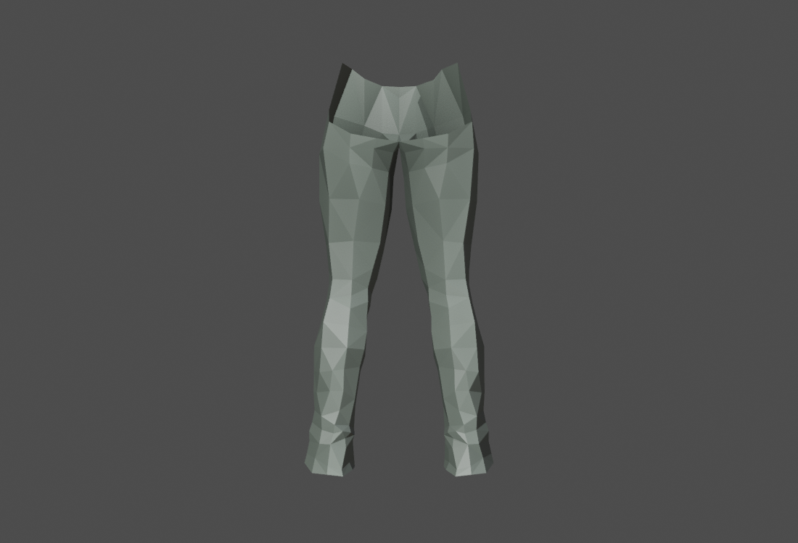 | 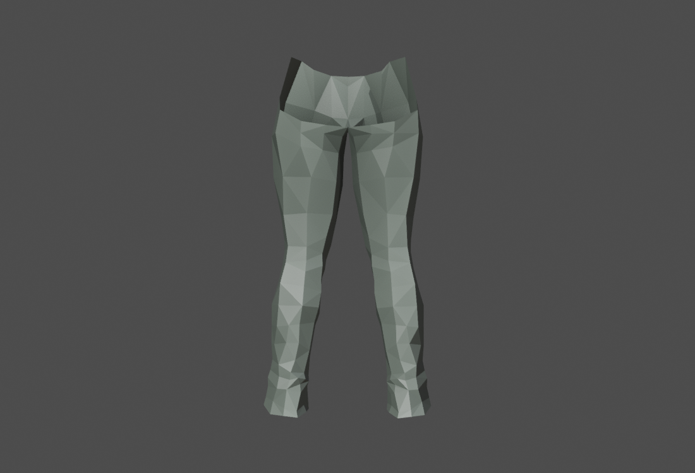 |
| 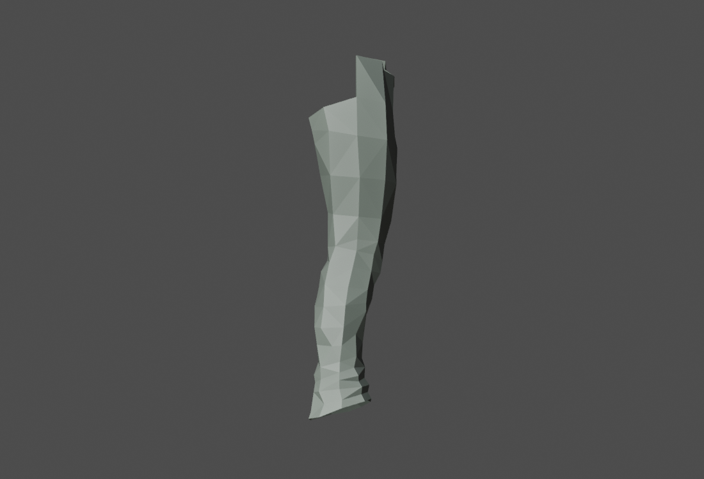 | 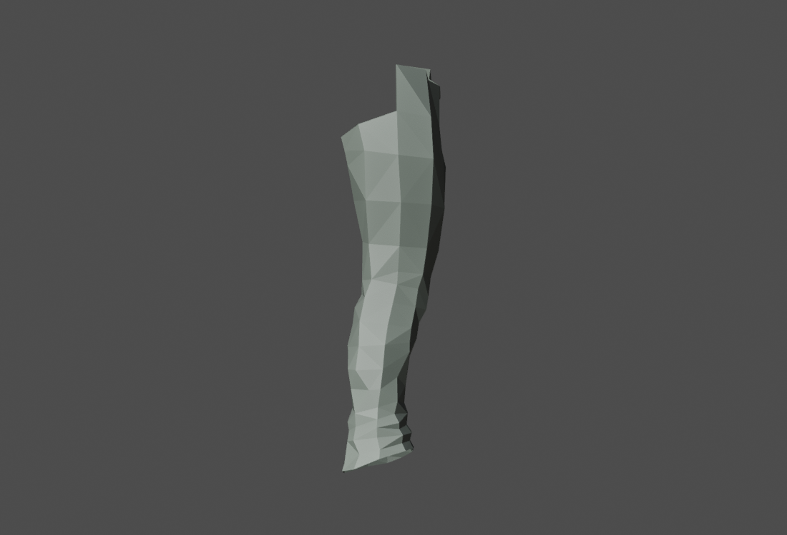 |

## Integrated workflow and remaining work

[fit_acceptance.rs](crates/sculpto-engine/tests/fit_acceptance.rs) checks written
output independently of command reports: full solid references, source topology,
body contacts, inside counts, self contacts, orientation, fixed silhouette,
weights, locks and posed follow through GLB/Actor. It composes placed body and
feet through the existing named NIF reference API. The portable transformed
extra-part regression passes. The expanded configured run now includes male
feet too: male reference10630 vertices/20318 faces, female5825/10488.

The latest registered-command run fails only Sentinel Armor001 among the five
ordinary cases:148 body contacts/74 inside groups. Auxiliary Armor001_1, prepared
Nightshade pants, belt and sleeves pass geometry, weights, masks, locks and posed
follow. Complete male and female reference parts remain included.
Actual suite result:4 tests pass,1 configured geometry test fails,45.31s total.
Build and scoped Clippy pass. No complete gate or main landing is claimed.

### Earlier auxiliary experiments — historical

Before the integrated opening repair, Sentinel auxiliary diagnosis localized11 foot contacts to three
retained ankle faces (1151,1182,1183). Its source already has a waist and two open
cuffs. Existing guide-facing selection retains those faces while removing40
others and creating an unwanted fourth opening; that preparation is rejected.
That diagnosis required preserving construction while addressing the ankle faces. No contact-driven trimming was applied.

A whole-face plane diagnostic clears the11 contacts with0inside/new self/flips,
but is rejected for deformation: one cuff edge contracts from1.75 to0.58 source
units. The source-direct variant also stretches a thigh edge from1.64 to4.71.
That rejected candidate retained honest residuals; zero contacts alone was insufficient.

Connected contact-patch translation with displacement propagation also clears
the auxiliary piece in two stages, with no inside/new self/flips and original
IoU0.96282. It preserves the contacted faces' internal shape, but a neighboring
edge still stretches0.60→1.05 units (source strain0.748). That exceeds the enabled
local deformation bound; that diagnostic was rejected. It is not the later
whole-opening implementation used by the current checkpoint.

A later auxiliary candidate passes static checks: move the complete cuff openings
upward by1.72/1.77 source units with a bounded geodesic transition. This slightly
shortens fitted legs while retaining opening XY shape,702vertices/1200faces and
exact welded seams. Full body+feet contacts,inside,new self and flips are0;
original IoU0.94962≥0.90407; additional symmetric edge strain0.13039≤0.3.
Worst source strain stays at the existing fit's0.40414. This diagnostic became
the reusable opening repair; its command/weight/pose verification is recorded above.

Matched geometric review now confirms the cuff contour is retained with a raised
hem. The crops include the actual full-reference feet in blue; cameras and scale
are shared. These are diagnostic REST views, not textured or animation acceptance.

| Original | Opening-lift candidate |
|---|---|
| 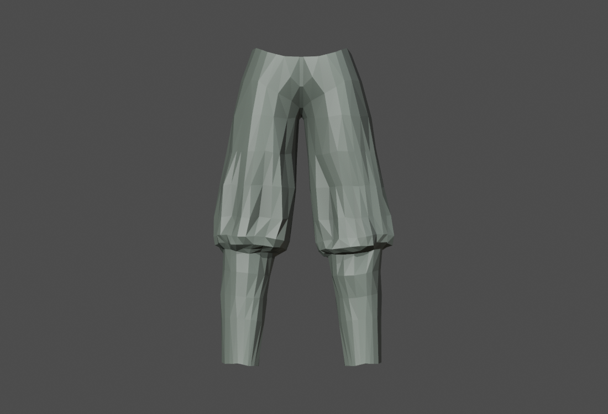 | 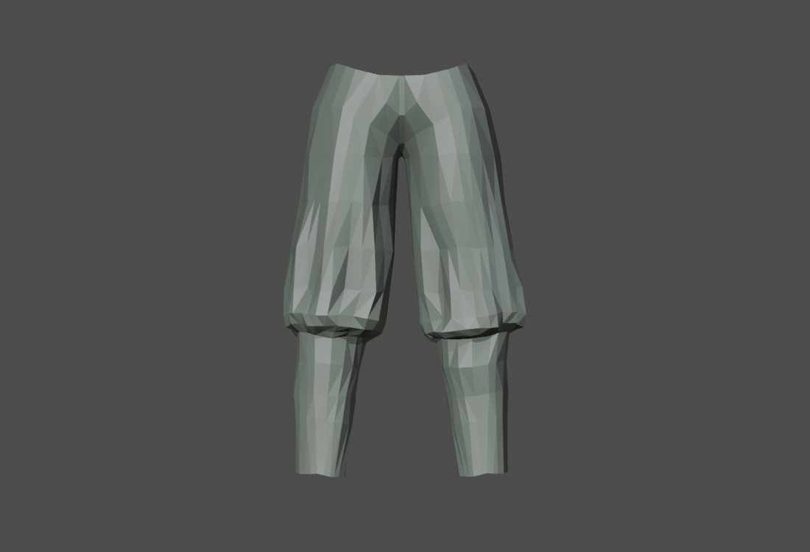 |
| 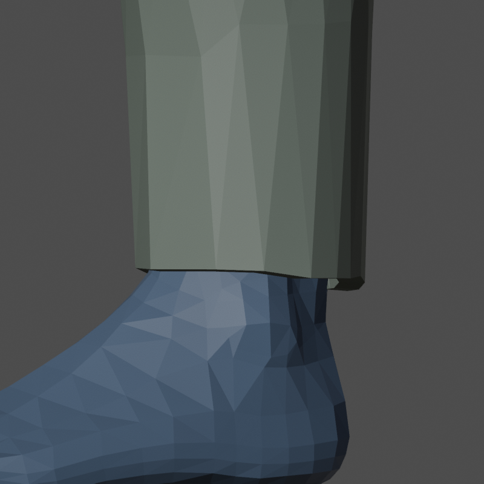 | 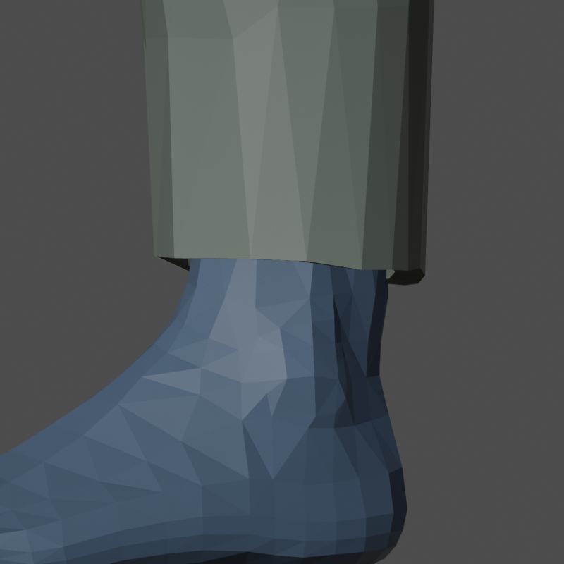 |
| 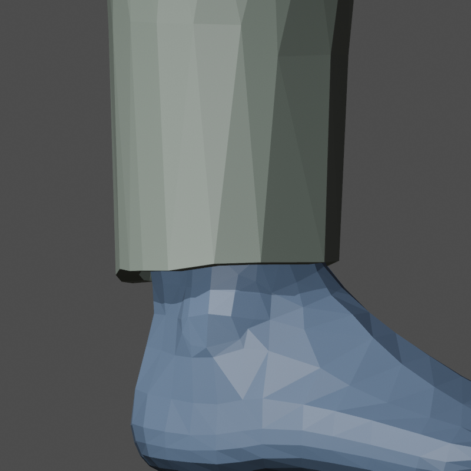 | 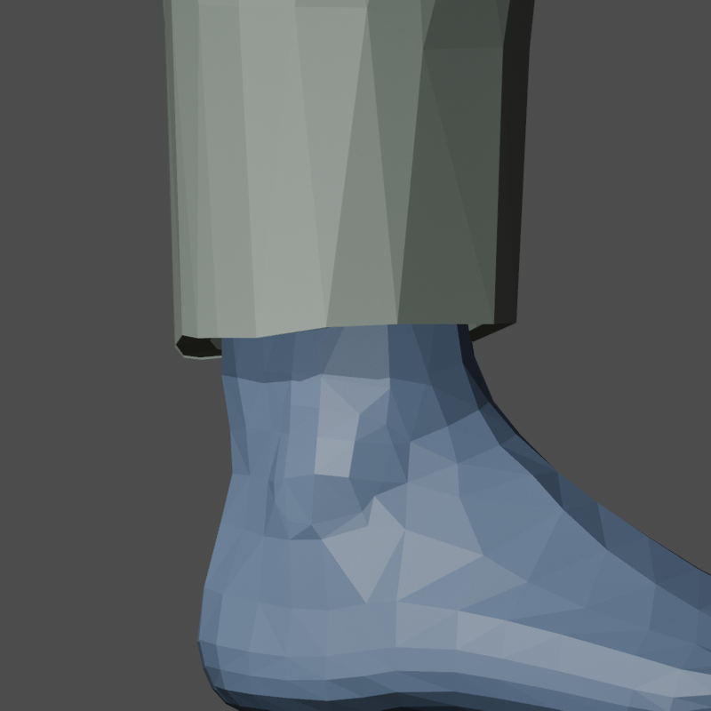 |

Reusable opt-in repair is implemented with an explicit caller direction,
boundary-contact admission, masks/rigid parts, bounded work and measured quality
guards. Interior contacts cannot choose a distant opening for this repair.

### Remaining acceptance

- Complete appearance/export qualification beyond the verified pants
  preparation, clipping, lineage and fitted pose path.
- Resolve Sentinel main coat without new folds or lost silhouette. Native and Rust
  diagnostic variants remain unqualified.
- Complete the robe's ordinary/Blender Cloth boundary acceptance.
- Run the complete configured acceptance and destination gates, then land
  both implementation and coordinator records. Only then mark FIT-08 Done.

Blender owns cloth simulation. Sculpto selects which parts/regions use Blender
Cloth and which use ordinary rigging; HDT/Bullet runtime work is outside this
scope. Work has resumed from the published graceful sleep checkpoint; FIT-08
remains unfinished.

## Negative evidence retained

The diagnostic tests on this branch preserve failed cases:
[fit recovery](crates/sculpto-mesh/tests/fit_recovery.rs),
[horizontal cuff preparation](crates/sculpto-mesh/tests/source_preparation.rs),
[native candidate composition](crates/sculpto-mesh/tests/native_candidate.rs)
and [unrecovered outward selection](crates/sculpto-mesh/tests/exterior_render.rs).
Some configured diagnostic cases deliberately fail their quality assertions.

A previous native frame-selection error is corrected: intermediate frame 1
was mistakenly treated as final. The last saved capped-source frame clears
contacts but fails the original silhouette frame. Applying original stand-offs
through the existing Rust FromShape API reintroduced 743 contacts and 42 new
self contacts. Neither result is accepted. The recovered open-surface result
above is a distinct, fully recorded source-construction route.

## UMA reference

The operator requested UMA intake before considering algorithm reuse.
[UMA upstream](https://github.com/umasteeringgroup/UMA) is present in the local
source collection, refreshed to master
`0d65997d319d8e08f478c540d171f03e5da1979a` and catalogued. Its clothing conformer,
binding data, mesh utility and tests were audited by three independent
DeepSeek workers: binding/topology, collision/seams, and tests/callers. No UMA
algorithm has been adopted or credited with closing FIT-08. Unreal is outside
this investigation.

Source-backed conclusions at that pin:

- A changed body or clothing topology requires rebinding. The conformer does
  not supply correspondence between arbitrary body topologies.
- Collision correction pushes vertices along their mapped surface normals;
  it does not prove triangle/edge clearance or preserve a measured contact set.
- Its dedicated test file contains four mathematical helper cases; those
  tests do not exercise the complete binding/conforming/export workflow.
- Useful future audit targets are explicit binding identity, reporting failed
  correspondence, and negative cases around UV seams and postprocessing.
  Sculpto already owns triangle-frame offset transport and guarded clipping;
  replacing those implementations wholesale is not justified by this audit.

Primary sources: [conformer](https://github.com/umasteeringgroup/UMA/blob/0d65997d319d8e08f478c540d171f03e5da1979a/UMAProject/Assets/UMA/Core/Scripts/ClothingConformer/UMAClothingConformer.cs#L349),
[collision correction](https://github.com/umasteeringgroup/UMA/blob/0d65997d319d8e08f478c540d171f03e5da1979a/UMAProject/Assets/UMA/Core/Scripts/ClothingConformer/UMAClothingConformer.cs#L957),
[tests](https://github.com/umasteeringgroup/UMA/blob/0d65997d319d8e08f478c540d171f03e5da1979a/UMAProject/Assets/UMA/Core/Editor/Tests/UMAClothingConformerTests.cs).
This was a source audit; Unity tests were not run.
